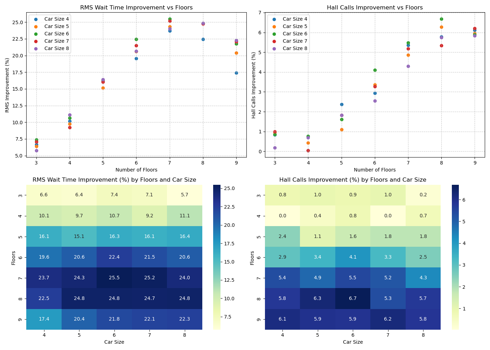
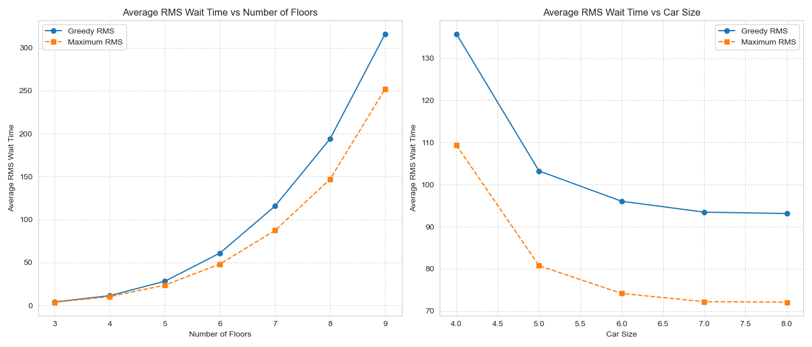

# Elevator Dispatch Optimization: Monte Carlo Heuristics vs. Deep Q-Learning

A Monte Carlo study of single-car elevator dispatch rules. A "maximum-distance" rule (similar to the LOOK disk-scheduling algorithm) cut root-mean-square (RMS) passenger wait time by 5.7% to 25.5% compared with a greedy nearest-request rule, depending on building size. A deep Q-network trained on the same problem did not beat the simple heuristic.

## Question

How should a single elevator car decide where to go next, and can a learned policy beat simple, explainable rules?

## Method

**Simulation**
- Discrete-time simulation of one car serving hall calls (up and down) and cabin calls.
- Passenger arrivals at each floor and direction are Poisson (rate 0.025 per time step).
- Each setting runs for 1,000,000 time steps, across 3 to 9 floors and car capacities of 4 to 8.
- Metric: RMS wait time, which penalizes long waits more heavily than the mean does.

**Heuristics compared**
- **Maximum-distance** (LOOK-style): keep moving in the current direction until no requests remain beyond the car, then reverse.
- **Greedy / nearest request** (SSTF-style): always head to the closest outstanding request.
- **Lazy baseline**: the car stays where it is.

**Deep Q-network** (TensorFlow/Keras)
- Bellman-target Q-learning with a replay buffer, a separate target network, epsilon-greedy exploration and the AdamW optimizer.
- Curriculum training: weights are transferred from a capacity-1 network to capacity 2, 3, ... 6 as the state grows (`deep-q-learning/transfer-weights-scripts/`).

## Results

Maximum-distance beat greedy in every configuration. The gain grows with building height, peaks at 25.5% (7 floors, car size 6), and dips slightly at 9 floors.



Average RMS wait for both rules as floors and car size change:



**DQN.** In a 10-floor, capacity-5 evaluation (1,000 runs of 1,000 time steps, `deep-q-learning/results/results.csv`), final RMS wait was:

| Policy | RMS wait (time steps) |
|---|---|
| Maximum-distance | 52.4 |
| Greedy | 52.4 |
| DQN with occasional random actions (`e-Neural`) | 73.3 |
| DQN, pure greedy argmax (`Neural`) | 912.2 |
| Lazy baseline | 913.3 |

## Takeaways

- A simple, explainable rule (keep going in one direction while there is work ahead) wins, and its advantage grows with building height.
- The DQN underperformed the heuristic. Left to its own argmax, it got stuck and did no better than standing still; injecting random actions helped but still trailed by about 40%.
- Likely reasons: the state shown to the agent may not capture everything that drives future waits (so the problem as modeled may not be truly Markov), the reward is a short-term proxy for a long-run RMS objective, and a policy trained at one capacity did not generalize cleanly to others.

## Repo layout

| Folder | Contents |
|---|---|
| `monte-carlo-heuristics/` | Maximum-distance and greedy simulations, data-collection sweeps, sample traces |
| `deep-q-learning/training-and-evaluation-code/` | Environment, agent, replay buffer, training loop, evaluation against heuristics |
| `deep-q-learning/transfer-weights-scripts/` | Curriculum weight transfer between car capacities |
| `deep-q-learning/saved-models/` | Trained Keras models (capacity 5) |
| `deep-q-learning/results/` | Figures and `results.csv` |
| `deep-q-learning/Archive/` | Earlier training script |

## How to run

Python 3.11. The saved models use the TensorFlow SavedModel format, which needs TensorFlow 2.15 or earlier to load with `tf.keras.models.load_model`.

```bash
pip install "tensorflow<2.16" numpy pandas matplotlib seaborn
```

```bash
cd monte-carlo-heuristics && python maxDistanceData.py
```

```bash
cd deep-q-learning/training-and-evaluation-code && python deterministicVsNeural.py
```

Paths are relative to the repo. Training logs go to `deep-q-learning/training-reports/`. The evaluation script appends to `deep-q-learning/results/evalTest.csv` and `numReqs.csv`, which you need to create first (`results.csv` is an earlier copy of the evaluation output). The full heuristic sweeps run 1,000,000 time steps per setting and take a while.

## Context

Solo directed-study project for MATH 1902 at the University of Pittsburgh, 2024 to 2025, advised by Dr. Jeffrey Wheeler.
